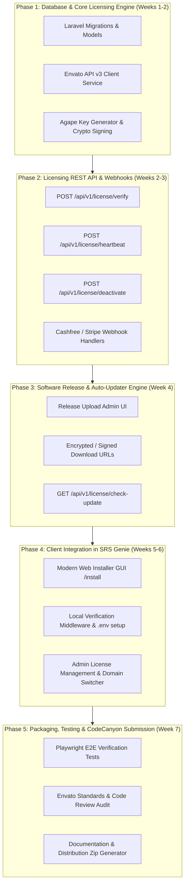

# Agape Central Licensing Server — Master Implementation Roadmap

**Document Type:** Strategic Engineering Specification & Roadmap  
**Target Platform:** AgapeInfosys Central Licensing Hub (`agapeinfosys.com`)  
**Client Applications:** SRS Genie, future Agape AI & SaaS products  
**Sales Channels:** Envato Market (CodeCanyon) + Direct Sales (`agapeinfosys.com` via Cashfree/Stripe)  
**Standard Compliance:** Envato Market Author Guidelines, OWASP API Security Top 10, RFC 8032 (Ed25519)  
**Version:** 1.0.0  
**Target Release Date:** Q1 2027  

---

## 1. Executive Summary

This engineering blueprint specifies the creation of a **Central Licensing Server** inside the `agapeinfosys` Laravel platform. It provides a unified licensing, domain-locking, and auto-update mechanism for software sold either through **CodeCanyon** (Envato Market) or **Directly on agapeinfosys.com**.

### Key Architectural Pillars
1. **Dual-Channel Ingestion:** Accepts both **Envato Purchase Codes** (validated via Envato API v3) and native **Agape License Keys** (generated upon checkout completion).
2. **Strict CodeCanyon Compliance:** Zero IonCube or unreadable encryption, ensuring 100% compliance with Envato submission policies, while protecting IP through domain-binding, signed heartbeat tokens, and cloud template updates.
3. **Cryptographic Integrity:** Uses asymmetric digital signatures (Ed25519) and HMAC-SHA256 to ensure license payloads cannot be forged, manipulated, or transferred without authorization.
4. **Automated Release & Update Delivery:** Secure distribution of production update zips with SHA-256 verification, enabling 1-click updates in client installations.

---

## 2. Document Suite Structure

All technical documentation for this module is structured into the following files inside `D:\PROJECTS\agapeinfosys\Central Licensing Server`:

| Document | Purpose | Primary Stakeholder |
| :--- | :--- | :--- |
| **`00-MASTER-IMPLEMENTATION-ROADMAP.md`** | High-level roadmap, phases, milestones, risk matrix | Tech Lead / Project Manager |
| **`01-SYSTEM-ARCHITECTURE-AND-REQUIREMENTS.md`** | Component topology, verification workflows, Envato compliance rules | Systems Architect |
| **`02-DATABASE-SCHEMA-AND-MIGRATIONS.md`** | Relational schemas, Eloquent models, and database migration specs | Backend Engineer |
| **`03-LARAVEL-API-IMPLEMENTATION-SPEC.md`** | Controllers, Services, Webhooks, Route signatures, and test cases | Laravel Developer |
| **`04-CLIENT-APP-INTEGRATION-SRS-GENIE.md`** | Client setup installer wizard, local verification gate, and auto-updater | Fullstack / Product Developer |
| **`05-ANTI-PIRACY-AND-PROTECTION-STRATEGY.md`** | Anti-nulling protection, telemetry, blacklisting, and cloud-synced assets | Security & Operations Engineer |

---

## 3. Phased Implementation Roadmap

---

## 4. Phase Breakdown & Deliverables

### Phase 1: Database & Core Licensing Engine (Days 1–10)
- [ ] Create database migrations:
  - `software_products`: Registry of software assets (`srs-genie`, item ID, price, latest release).
  - `licenses`: Store purchase codes, customer details, license channel, tier, max domains, status.
  - `domain_bindings`: Tracks active domains (`example.com`), IPs, install paths, activation timestamps.
  - `software_releases`: Version strings, changelog markdown, zip file paths, sha256 checksums.
  - `license_audit_logs`: Detailed audit trail of activations, heartbeats, IP addresses, user agents.
- [ ] Build `EnvatoVerificationService`: Integration with `https://api.envato.com/v3/market/author/sale`.
- [ ] Build `AgapeLicenseService`: Format `AGAPE-SRS-XXXX-XXXX-XXXX` with Luhn check digit.

### Phase 2: Licensing REST API & Webhooks (Days 11–20)
- [ ] Implement `LicenseApiController` under `routes/api.php` with `/v1/license` prefix.
- [ ] Implement rate-limiting middleware (`throttle:30,1`) to prevent brute-forcing purchase codes.
- [ ] Implement Cashfree and Stripe webhook listeners to instantly issue Agape license keys upon order completion.
- [ ] Automated email dispatch containing license key, invoice PDF, and setup guide.

### Phase 3: Software Release & Auto-Updater Engine (Days 21–28)
- [ ] Admin management panel inside AgapeInfosys for publishing new releases (`v2.5.0`, `v2.6.0`).
- [ ] Secure file storage in private AWS S3 or private local storage (`storage/app/releases`).
- [ ] API endpoint for update verification: returns available update version, release notes, and a 60-minute signed download URL.

### Phase 4: Client Integration in SRS Genie (Days 29–40)
- [ ] Web-based graphical installer (`/install`):
  1. Server requirements verification (PHP 8.2+, MySQL 8+, PDO, cURL, OpenSSL, ZipArchive).
  2. Database credentials test & automated schema migration.
  3. License key / Envato code activation & domain binding.
  4. Super-Admin credentials configuration.
- [ ] Local license middleware (`public/api/license_check.php`): fast offline HMAC verification.
- [ ] Settings tab in SRS Genie Admin Panel: display active license, bound domain, and renewal status.

### Phase 5: Verification, Packaging & CodeCanyon Submission (Days 41–48)
- [ ] Execute Playwright E2E suite covering:
  - Clean installation flow with valid Envato code.
  - Clean installation flow with valid Agape key.
  - Rejection on invalid key or domain limit breach.
  - Localhost / staging domain exemption (`localhost`, `127.0.0.1`, `dev.*`).
- [ ] CodeCanyon zip packaging: strip development files (`node_modules`, `.git`, `.env.local`).
- [ ] Complete `Documentation/index.html` adhering to Envato requirements.

---

## 5. Risk Assessment & Mitigation

| Risk | Impact | Probability | Mitigation Strategy |
| :--- | :--- | :--- | :--- |
| **Envato Rejection for Obfuscation** | High | Low | Zero obfuscation in PHP backend. Protect via API licensing, domain binding, and minified client assets only. |
| **License Nulling / Piracy** | Medium | High | Keep high-value AI templates, model definitions, and updates cloud-synced from `agapeinfosys.com`. |
| **Envato API Downtime** | Medium | Low | Cache verified Envato purchase codes locally in `licenses` table so subsequent checks don't fail during Envato outages. |
| **Buyer Staging/Localhost Frustration** | Medium | Medium | Hardcode whitelist for `localhost`, `127.0.0.1`, `*.test`, `*.local`, and `staging.*` so developers can test without wasting live seat allocations. |
| **Brute-Force License Key Probing** | High | Medium | Redis sliding-window rate limiting + temporary IP banning after 5 consecutive failed verification attempts. |
