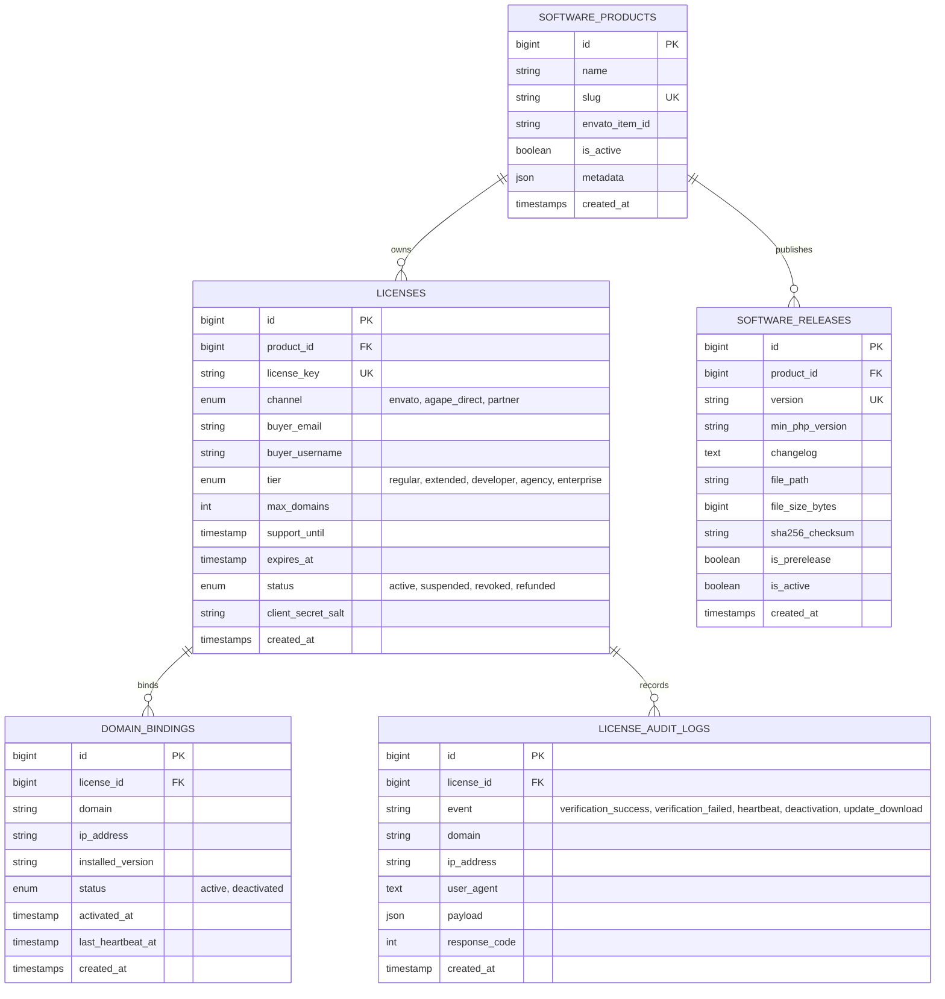

# Agape Central Licensing Server — Database Schema & Migrations

**Document Type:** Database Design & Laravel Migration Specification  
**Platform:** Laravel 11+ / MySQL 8.0+  
**Target Project:** `D:\PROJECTS\agapeinfosys`  
**Version:** 1.0.0  

---

## 1. Entity-Relationship Diagram



---

## 2. Laravel Migration Blueprint

Create the migration using:
```bash
php artisan make:migration create_licensing_tables
```

Migration content (`database/migrations/xxxx_xx_xx_create_licensing_tables.php`):

```php
<?php

use Illuminate\Database\Migrations\Migration;
use Illuminate\Database\Schema\Blueprint;
use Illuminate\Support\Facades\Schema;

return new class extends Migration
{
    public function up(): void
    {
        // 1. Software Products Table
        Schema::create('software_products', function (Blueprint $table) {
            $table->id();
            $table->string('name', 150);
            $table->string('slug', 80)->unique(); // e.g. 'srs-genie'
            $table->string('envato_item_id', 50)->nullable()->index(); // Envato marketplace item ID
            $table->boolean('is_active')->default(true);
            $table->json('metadata')->nullable(); // Pricing, feature flags, custom settings
            $table->timestamps();
        });

        // 2. Licenses Table
        Schema::create('licenses', function (Blueprint $table) {
            $table->id();
            $table->foreignId('product_id')->constrained('software_products')->cascadeOnDelete();
            $table->string('license_key', 100)->unique()->index();
            $table->enum('channel', ['envato', 'agape_direct', 'partner'])->default('agape_direct');
            $table->string('buyer_email')->nullable()->index();
            $table->string('buyer_username')->nullable();
            $table->enum('tier', ['regular', 'extended', 'developer', 'agency', 'enterprise'])->default('regular');
            $table->unsignedInteger('max_domains')->default(1);
            $table->timestamp('support_until')->nullable();
            $table->timestamp('expires_at')->nullable(); // Null for perpetual licenses
            $table->enum('status', ['active', 'suspended', 'revoked', 'refunded'])->default('active');
            $table->string('client_secret_salt', 64); // Unique per-license salt for HMAC hashing
            $table->timestamps();
        });

        // 3. Domain Bindings Table
        Schema::create('domain_bindings', function (Blueprint $table) {
            $table->id();
            $table->foreignId('license_id')->constrained('licenses')->cascadeOnDelete();
            $table->string('domain', 191)->index();
            $table->string('ip_address', 45)->nullable();
            $table->string('installed_version', 30)->nullable();
            $table->enum('status', ['active', 'deactivated'])->default('active');
            $table->timestamp('activated_at')->useCurrent();
            $table->timestamp('last_heartbeat_at')->nullable();
            $table->timestamps();

            $table->unique(['license_id', 'domain']);
        });

        // 4. Software Releases Table
        Schema::create('software_releases', function (Blueprint $table) {
            $table->id();
            $table->foreignId('product_id')->constrained('software_products')->cascadeOnDelete();
            $table->string('version', 30); // e.g. '2.5.0'
            $table->string('min_php_version', 10)->default('8.2.0');
            $table->longText('changelog')->nullable();
            $table->string('file_path', 255); // Path in private disk: storage/app/releases/...
            $table->unsignedBigInteger('file_size_bytes')->default(0);
            $table->string('sha256_checksum', 64);
            $table->boolean('is_prerelease')->default(false);
            $table->boolean('is_active')->default(true);
            $table->timestamps();

            $table->unique(['product_id', 'version']);
        });

        // 5. License Audit Logs Table
        Schema::create('license_audit_logs', function (Blueprint $table) {
            $table->id();
            $table->foreignId('license_id')->nullable()->constrained('licenses')->nullOnDelete();
            $table->string('event', 50)->index();
            $table->string('domain', 191)->nullable()->index();
            $table->string('ip_address', 45)->nullable();
            $table->text('user_agent')->nullable();
            $table->json('payload')->nullable();
            $table->unsignedSmallInteger('response_code')->default(200);
            $table->timestamp('created_at')->useCurrent();
        });
    }

    public function down(): void
    {
        Schema::dropIfExists('license_audit_logs');
        Schema::dropIfExists('software_releases');
        Schema::dropIfExists('domain_bindings');
        Schema::dropIfExists('licenses');
        Schema::dropIfExists('software_products');
    }
};
```

---

## 3. Eloquent Model Definitions

### 1. `SoftwareProduct.php`
```php
namespace App\Models;

use Illuminate\Database\Eloquent\Model;
use Illuminate\Database\Eloquent\Relations\HasMany;

class SoftwareProduct extends Model
{
    protected $fillable = ['name', 'slug', 'envato_item_id', 'is_active', 'metadata'];
    protected $casts = [
        'is_active' => 'boolean',
        'metadata' => 'array',
    ];

    public function licenses(): HasMany
    {
        return $this->hasMany(License::class, 'product_id');
    }

    public function releases(): HasMany
    {
        return $this->hasMany(SoftwareRelease::class, 'product_id');
    }

    public function latestRelease()
    {
        return $this->hasOne(SoftwareRelease::class, 'product_id')->where('is_active', true)->latestOfMany();
    }
}
```

### 2. `License.php`
```php
namespace App\Models;

use Illuminate\Database\Eloquent\Model;
use Illuminate\Database\Eloquent\Relations\BelongsTo;
use Illuminate\Database\Eloquent\Relations\HasMany;

class License extends Model
{
    protected $fillable = [
        'product_id', 'license_key', 'channel', 'buyer_email', 'buyer_username',
        'tier', 'max_domains', 'support_until', 'expires_at', 'status', 'client_secret_salt'
    ];

    protected $casts = [
        'support_until' => 'datetime',
        'expires_at' => 'datetime',
        'max_domains' => 'integer',
    ];

    public function product(): BelongsTo
    {
        return $this->belongsTo(SoftwareProduct::class, 'product_id');
    }

    public function domainBindings(): HasMany
    {
        return $this->hasMany(DomainBinding::class);
    }

    public function activeBindings(): HasMany
    {
        return $this->domainBindings()->where('status', 'active');
    }

    public function auditLogs(): HasMany
    {
        return $this->hasMany(LicenseAuditLog::class);
    }

    public function isValid(): bool
    {
        if ($this->status !== 'active') return false;
        if ($this->expires_at && $this->expires_at->isPast()) return false;
        return true;
    }
}
```

### 3. `DomainBinding.php`
```php
namespace App\Models;

use Illuminate\Database\Eloquent\Model;
use Illuminate\Database\Eloquent\Relations\BelongsTo;

class DomainBinding extends Model
{
    protected $fillable = [
        'license_id', 'domain', 'ip_address', 'installed_version', 'status',
        'activated_at', 'last_heartbeat_at'
    ];

    protected $casts = [
        'activated_at' => 'datetime',
        'last_heartbeat_at' => 'datetime',
    ];

    public function license(): BelongsTo
    {
        return $this->belongsTo(License::class);
    }
}
```
