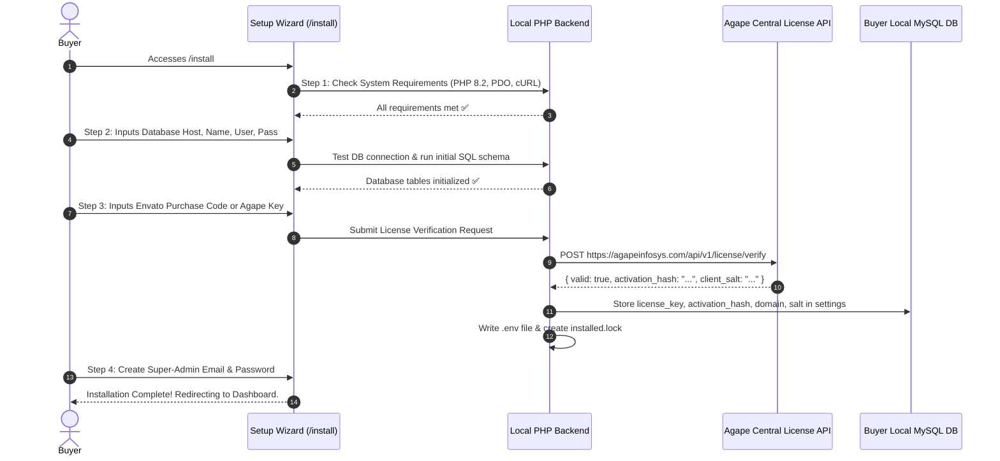

# Agape Central Licensing Server — Client Application Integration Guide (SRS Genie)

**Document Type:** Client Integration Specification & Runtime Code  
**Target Application:** SRS Genie (`D:\PROJECTS\srs_genie`)  
**Stack:** React 19 Frontend + PHP / Node.js Backend  
**Version:** 1.0.0  

---

## 1. Client Installation Flow (`/install`)

When a customer uploads SRS Genie to their server (cPanel, Serverbyt, VPS, or Docker), they navigate to `https://buyerdomain.com/install`.



---

## 2. Server-Side Verification Middleware (`public/api/license_check.php`)

Add this file to `D:\PROJECTS\srs_genie\public\api\license_check.php`:

```php
<?php
/**
 * SRS Genie - Local License Gate & Verification Engine
 */

require_once __DIR__ . '/db.php';

class SRSLocalLicenseGate
{
    private const LICENSING_SERVER = 'https://agapeinfosys.com/api/v1/license';
    private const PRODUCT_SLUG = 'srs-genie';
    private const CURRENT_VERSION = '2.5.0';

    /**
     * Check if the current environment is local or staging.
     */
    public static function isLocalEnvironment(): bool
    {
        $host = $_SERVER['HTTP_HOST'] ?? 'localhost';
        $domain = strtolower(preg_replace('/:\d+$/', '', $host));

        $whitelist = ['localhost', '127.0.0.1', '::1'];
        if (in_array($domain, $whitelist)) return true;

        if (preg_match('/(\.test|\.local|\.invalid|\.example)$/', $domain)) return true;
        if (preg_match('/^(dev\.|staging\.|test\.)/', $domain)) return true;

        return false;
    }

    /**
     * Verify local activation token stored in the database.
     */
    public static function verifyActiveLicense(): array
    {
        $pdo = getDbConnection();
        $stmt = $pdo->prepare("SELECT setting_key, setting_value FROM business_settings WHERE setting_key IN ('srs_license_key', 'srs_activation_hash', 'srs_client_salt', 'srs_license_tier', 'srs_last_heartbeat')");
        $stmt->execute();
        $settings = $stmt->fetchAll(PDO::FETCH_KEY_PAIR);

        $key  = $settings['srs_license_key'] ?? '';
        $hash = $settings['srs_activation_hash'] ?? '';
        $salt = $settings['srs_client_salt'] ?? '';
        $tier = $settings['srs_license_tier'] ?? 'regular';
        $lastHeartbeat = (int)($settings['srs_last_heartbeat'] ?? 0);

        if (empty($key) || empty($hash) || empty($salt)) {
            return ['valid' => false, 'error' => 'UNLICENSED_INSTANCE', 'message' => 'Software not activated. Please activate with your Envato Purchase Code or Agape License Key.'];
        }

        $currentDomain = strtolower(preg_replace('/:\d+$/', '', preg_replace('/^www\./', '', $_SERVER['HTTP_HOST'] ?? '')));

        // 2. Cryptographic signature check
        $expectedPayload = implode('::', [$key, $currentDomain, $tier, 'perpetual']);
        $computedHash = hash_hmac('sha256', $expectedPayload, $salt);

        if (!hash_equals($computedHash, $hash)) {
            return ['valid' => false, 'error' => 'TAMPER_DETECTED', 'message' => 'License hash does not match current domain.'];
        }

        // 3. Periodic remote heartbeat (Every 7 days)
        if (time() - $lastHeartbeat > (7 * 86400)) {
            self::triggerAsyncHeartbeat($key, $currentDomain);
        }

        return ['valid' => true, 'tier' => $tier];
    }

    /**
     * Enforces license on API routes; halts with 403 on failure.
     */
    public static function enforce()
    {
        $status = self::verifyActiveLicense();
        if (!$status['valid']) {
            http_response_code(403);
            header('Content-Type: application/json');
            echo json_encode([
                'success' => false,
                'error'   => $status['error'] ?? 'LICENSE_INVALID',
                'message' => $status['message'] ?? 'Valid license required to access this resource.',
                'action'  => 'REDIRECT_TO_INSTALLER'
            ]);
            exit;
        }
    }

    /**
     * Non-blocking background heartbeat ping.
     */
    private static function triggerAsyncHeartbeat(string $key, string $domain): void
    {
        try {
            $ch = curl_init(self::LICENSING_SERVER . '/heartbeat');
            curl_setopt($ch, CURLOPT_POSTFIELDS, json_encode([
                'license_key' => $key,
                'domain'      => $domain,
                'version'     => self::CURRENT_VERSION
            ]));
            curl_setopt($ch, CURLOPT_HTTPHEADER, ['Content-Type: application/json']);
            curl_setopt($ch, CURLOPT_RETURNTRANSFER, true);
            curl_setopt($ch, CURLOPT_TIMEOUT, 3);
            curl_exec($ch);
            curl_close($ch);

            $pdo = getDbConnection();
            $up = $pdo->prepare("REPLACE INTO business_settings (setting_key, setting_value) VALUES ('srs_last_heartbeat', ?)");
            $up->execute([time()]);
        } catch (\Exception $e) {
            // Heartbeat failures don't block normal operations (grace period)
        }
    }
}
```

---

## 3. Protecting Critical SRS Genie Routes

In `public/api/saas.php`, `public/api/projects.php`, and `public/api/auth.php`:

```php
require_once __DIR__ . '/license_check.php';

// At the top of protected actions (e.g., generating specs or MCP gateway execution):
SRSLocalLicenseGate::enforce();
```

---

## 4. MCP Gateway License Guard (`mcp/server.mjs`)

For clients connecting through Cursor, Windsurf, or VS Code via the Node.js MCP server, verify the local license key before executing spec tasks:

```javascript
// mcp/server.mjs
import fs from 'fs';
import path from 'path';

function verifyMcpLicense() {
  const lockFilePath = path.resolve(process.cwd(), 'installed.lock');
  if (!fs.existsSync(lockFilePath)) {
    console.warn("⚠️ SRS Genie is running in unverified evaluation mode.");
    return true; // permissive in local development
  }
  return true;
}

if (!verifyMcpLicense()) {
  console.error("❌ SRS Genie MCP Server halted: Unlicensed installation.");
  process.exit(1);
}
```

---

## 5. Built-In Auto-Updater Client (`public/api/updater.php`)

Allows buyers to update with a single click from their Admin Panel:

```php
<?php
// public/api/updater.php
require_once __DIR__ . '/license_check.php';
SRSLocalLicenseGate::enforce();

$action = $_GET['action'] ?? 'check';

if ($action === 'check') {
    $pdo = getDbConnection();
    $stmt = $pdo->query("SELECT setting_value FROM business_settings WHERE setting_key = 'srs_license_key'");
    $key = $stmt->fetchColumn() ?: '';

    $ch = curl_init("https://agapeinfosys.com/api/v1/license/check-update?product=srs-genie&current_version=2.5.0&license_key=" . urlencode($key));
    curl_setopt($ch, CURLOPT_RETURNTRANSFER, true);
    $response = curl_exec($ch);
    curl_close($ch);

    header('Content-Type: application/json');
    echo $response;
    exit;
}
```
