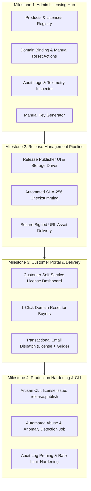

# Agape Central Licensing Server — Production Roadmap & Milestones

**Target Platform:** AgapeInfosys Web Platform (`agapeinfosys.com`)  
**Scope:** Central Licensing Server Production Readiness  
**Target Release Date:** Production 2026 / 2027  
**Status:** In Progress  

---

## Roadmap Overview

---

## Milestone 1: Admin Licensing Hub (Internal Operations)
*Provide administrators with comprehensive visibility and control over all software products, issued licenses, bound domains, and verification logs.*

- [x] **1.1 Software Products Management (`/admin/licensing/products`):**
  - List software assets (e.g. `srs-genie`, Envato item ID, metadata, status).
  - Create & edit software products.
  - Quick toggle for active/inactive status.
- [x] **1.2 Licenses Registry & Explorer (`/admin/licensing/licenses`):**
  - Search by license key, buyer email, buyer username, tier, channel (`envato` vs `agape_direct`), status (`active`, `suspended`, `revoked`, `refunded`).
  - License detail screen showing bound domain(s), IP address, installed version, and activation timestamps.
  - Admin Action Controls:
    - 1-click **Revoke / Suspend / Reactivate** status toggles.
    - 1-click **Unbind / Release Domain** to free seat allocations for customers.
    - **Extend Support Period** or modify maximum allowed domains (`max_domains`).
    - **Reissue Secret Salt** if compromised.
- [x] **1.3 Manual License Generator (`/admin/licensing/licenses/create`):**
  - UI form to issue custom partner, promotional, or enterprise keys directly.
- [x] **1.4 Real-Time Audit Trail Viewer (`/admin/licensing/audit-logs`):**
  - Searchable audit log viewer capturing all verification attempts, heartbeats, downloads, and errors.
  - Filter by event type, domain, IP address, or response status code.
- [x] **1.5 Navigation & Menu Integration:**
  - Add Licensing group with appropriate icons to the admin sidebar navigation.
- [x] **1.6 Feature & Unit Tests:**
  - Automated tests covering admin CRUD and license actions (8 tests, 52 assertions passed).

---

## Milestone 2: Release Management Pipeline
*Reliably package, store, and distribute release updates to authenticated buyers.*

- [x] **2.1 Release Management UI (`/admin/licensing/releases`):**
  - List all software versions for each product with file sizes and checksums.
  - Create release form with file upload for `.zip` update bundles.
  - Automatic `sha256_checksum` computation and byte size calculation upon upload.
  - Markdown editor/field for changelog notes and minimum PHP version.
  - Toggles for active status and pre-release flag.
- [x] **2.2 Secure Private Storage:**
  - Store release archives on private disk storage (`storage/app/private/releases` or private AWS S3).
  - Prevent direct URL or unauthorized access.
- [x] **2.3 Download Stream Verification:**
  - Validate 60-minute signed download URLs and active license status prior to streaming binary file downloads.
  - Integrated `ReleaseManagerService` for automated package storage, checksum validation, and secure streaming.

---

## Milestone 3: Customer Self-Service Portal & Transactional Delivery
*Ensure zero customer support friction for legitimate buyers on agapeinfosys.com.*

- [x] **3.1 Customer Account License Dashboard (`/dashboard/licenses`):**
  - Customer view displaying all purchased products and license keys.
  - Overview of currently bound domains and license expiration / support dates.
  - **Self-Service Domain Reset Button:** Allow buyers to unbind their active domain (rate-limited / recorded in audit log) without needing support intervention.
  - One-click download button for the latest authorized release zip.
- [x] **3.2 Transactional Email Dispatch:**
  - `LicenseIssuedMail`: Automated email sent immediately upon Cashfree/Stripe payment or manual issuance.
  - Contains: License key, product name, tier, download link, invoice details reference, and setup guide instructions.

---

## Milestone 4: Production Hardening, Telemetry & Artisan Tooling
*Ensure operational resilience, performance under load, and anti-abuse safeguards.*

- [x] **4.1 Artisan CLI Tooling:**
  - `php artisan license:issue {product-slug} {email} --tier=regular --channel=agape_direct`
  - `php artisan release:publish {product-slug} {version} {file-path} --changelog="..."`
  - `php artisan license:prune-logs --days=90` (scheduled audit cleanup).
- [x] **4.2 Automated Abuse & Anomaly Detection (Scheduled Job):**
  - Scheduled hourly monitor detecting:
    - **IP velocity anomalies** (> 10 distinct public IPs for a single regular license in 24 hours).
    - **Domain flooding** (repeated unauthorized activations).
  - Automatically flags/suspends compromised keys, invalidates bound domains, and records audit telemetry.
- [x] **4.3 Production Caching & Resilience:**
  - Throttled API endpoints with cache (`throttle:30,1`).
  - Graceful degradation and caching during Envato API outages.
